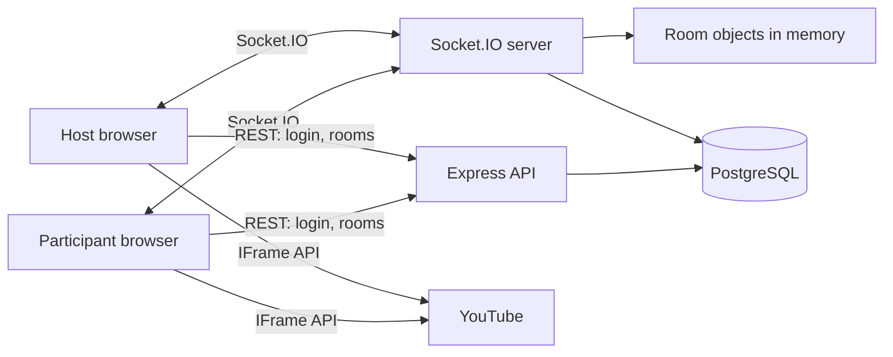
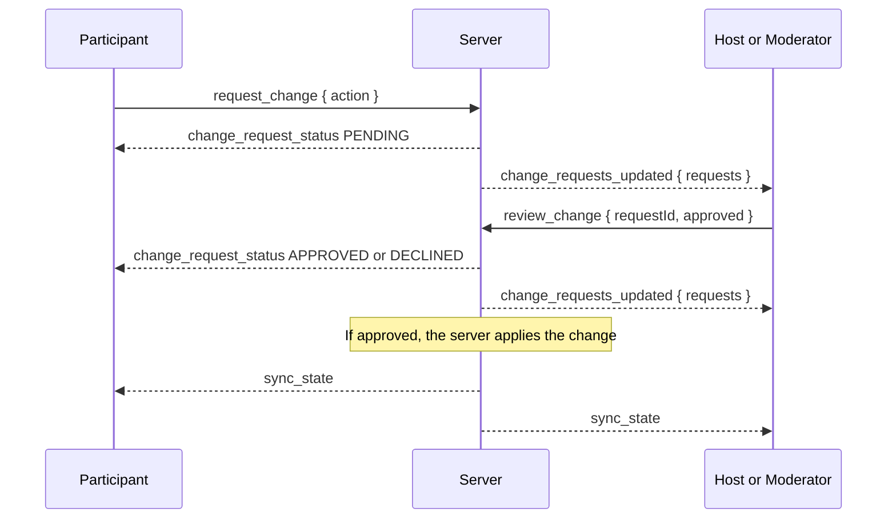
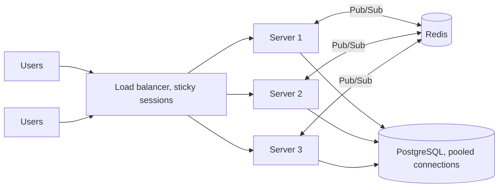

# SyncStream: YouTube Watch Party

Watch YouTube videos together in real time. When a host or moderator plays, pauses, seeks or changes the video, everyone in the room sees the same thing. Participants can ask for a change, and it only happens once a host or moderator approves it.

**Live app:** https://syncstream-nine.vercel.app
**Backend API docs:** https://syncstream-backend-dcc5.onrender.com/api-docs/

**Demo accounts** (or sign up with any email; a verification code is sent to it):

| Role to try | Email | Password |
| --- | --- | --- |
| Host | `sarthakkaushik927+host@gmail.com` | `12345678` |
| Participant | `sarthakkaushik927+participant@gmail.com` | `12345678` |

Sign in as the host in one browser and the participant in another (or a private window), then join the same room. The backend is on Render's free plan, so the first request after a quiet period can take up to a minute.

## Features

- Create a room, or join one by room code or link
- Synchronized play, pause, seek and video changes over WebSockets
- Host, Moderator and Participant roles, enforced on the server
- Approval flow: participants request playback changes, and a host or moderator approves or declines them
- The host can assign roles, transfer host, and remove participants (removed users can't rejoin that room)
- People joining mid-video start at the current position
- Login with email verification, saved rooms, room chat and emoji reactions

## Tech stack

| Layer | Technology |
| --- | --- |
| Frontend | React, TypeScript, Vite, Tailwind CSS, Zustand |
| Video | YouTube IFrame API (`react-youtube`) |
| Backend | Node.js, Express |
| Realtime | Socket.IO, with Redis Pub/Sub for running several servers (optional) |
| Database | PostgreSQL (Neon) with Sequelize |

## Run it locally

You need Node.js 22 or newer, pnpm and PostgreSQL. Docker is the quickest way to get PostgreSQL.

### 1. Backend

```bash
cd backend
docker compose up -d   # starts PostgreSQL on port 5432
pnpm install
```

Copy `backend/.env.example` to `backend/.env`. The defaults match the Docker database. `REDIS_URL` is optional: leave it empty to run one server.

```bash
pnpm dev
```

Database tables are created automatically on startup. The API runs on http://localhost:5000, with interactive docs at `/api-docs`.

### 2. Frontend

```bash
cd frontend
pnpm install
```

Copy `frontend/.env.example` to `frontend/.env`.

```bash
pnpm dev
```

Open http://localhost:5173. To try a room with two users, use a normal window and a private window.

## Architecture overview



**How WebSockets fit into the flow**

1. The client logs in over REST and receives a JWT. It then opens a Socket.IO connection, and the server verifies that token before accepting it.
2. `join_room` adds the socket to a Socket.IO room. The server replies with the current playback state, including time passed since the last change, and the participant list.
3. A playback action goes to the server, which checks the sender's role before doing anything. If allowed, it updates the in-memory `Room`, broadcasts `sync_state` to the room, and saves the change to PostgreSQL.
4. Each browser applies `sync_state` to its own YouTube player. YouTube streams the video to each browser separately; the server only syncs commands and positions.

**Server structure (`backend/src/websockets`)**

- `RoomManager` is a singleton that holds the active rooms.
- `Room` holds participants, playback state and pending requests, and works out the live position.
- `Participant` holds a user's socket ID and role.
- `socketHandlers.js` authenticates sockets, checks permissions and handles events.
- `RedisBroadcaster` shares room broadcasts between servers through Redis Pub/Sub when `REDIS_URL` is set.

**Approval flow**



**Scaling to many users and rooms**

One server keeps every user's connection, so a room broadcast reaches everyone. To serve 1,000+ users across 100+ rooms, the design runs several server instances behind a load balancer:



- **Redis Pub/Sub (built in):** each server only knows its own connections. With `REDIS_URL` set, `RedisBroadcaster` sends each room event (playback sync, chat, reactions) to its own users and publishes it on a Redis channel, tagged with the server's ID. Every other server is subscribed, and delivers the event to its own users in that room, ignoring its own messages. So people in the same room can be on different servers.
- **Safe startup:** when several servers start at once, a Postgres advisory lock makes them set up the tables one at a time.
- **Load balancer:** spreads connections across servers. It needs sticky sessions so each browser keeps talking to the same server during the Socket.IO handshake.
- **Connection pooling:** each server keeps a pool of up to 15 PostgreSQL connections instead of opening one per request.
- **Next step:** live room state (who is in the room, roles, pending requests) is still held in each server's memory, so membership and role updates stay on the server that holds them. For full multi-server rooms that state would move into Redis too, so any server can answer for any room.

## Roles

| Permission | Host | Moderator | Participant |
| --- | --- | --- | --- |
| Play, pause, seek, change video | Yes | Yes | Request only |
| Approve or decline requests | Yes | Yes | No |
| Make someone a moderator, or demote a moderator | Yes | Yes | No |
| Remove participants | Yes | Yes | No |
| Transfer host | Yes | No | No |
| Chat and reactions | Yes | Yes | Yes |

The room creator is the host. Everyone else joins as a participant. Nobody can demote or remove the host, or change their own role.

If the host leaves, a moderator stands in, or the first remaining participant if there are no moderators. The room still remembers its real host: when they rejoin, they get the host role back and the stand-in returns to their previous role. Transferring host makes the receiver the real host, so the same rule then applies to them. A lost connection gets 30 seconds to come back first, so a brief network drop doesn't cost the host their role.

## WebSocket events

| Event | Direction | Payload | Purpose |
| --- | --- | --- | --- |
| `join_room` | Client to server | `{ roomId }` | Join a room |
| `play_state_change` | Client to server | `{ isPlaying, currentTime, videoId }` | Play or pause (Host, Moderator) |
| `seek` | Client to server | `{ currentTime, videoId }` | Seek (Host, Moderator) |
| `change_video` | Client to server | `{ videoId }` | Change video (Host, Moderator) |
| `request_change` | Client to server | `{ action, currentTime?, videoId? }` | Ask for a change (Participant) |
| `review_change` | Client to server | `{ requestId, approved }` | Approve or decline (Host, Moderator) |
| `assign_role` | Client to server | `{ targetUserId, newRole }` | Assign a role (Host, Moderator) |
| `transfer_host` | Client to server | `{ targetUserId }` | Pass the host role (Host) |
| `remove_participant` | Client to server | `{ targetUserId }` | Remove a user (Host, Moderator) |
| `send_chat` | Client to server | `{ message }` | Send a chat message |
| `reaction` | Both | `{ emoji, userId, username }` | Emoji reaction |
| `sync_state` | Server to clients | `{ isPlaying, currentTime, videoId }` | Current playback state |
| `user_joined` | Server to client | `{ userId, role, playbackState, participants }` | Initial state for the joining user |
| `participants_updated` | Server to clients | `{ participants }` | Someone joined or left |
| `role_assigned` | Server to clients | `{ userId, role, participants }` | A role changed |
| `host_transferred` | Server to clients | `{ newHostId, previousHostId, participants }` | Host role moved |
| `participant_removed` | Server to clients | `{ userId, participants }` | A user was removed |
| `kicked` | Server to client | `{ message }` | You were removed, or can't rejoin |
| `change_requests_updated` | Server to client | `{ requests }` | Pending requests (only filled in for Host and Moderators) |
| `change_request_status` | Server to client | `{ requestId, status, action, currentTime?, videoId? }` | Your request's status |
| `chat_message` | Server to clients | `{ id, message, created_at, user }` | New chat message |
| `error_event` | Server to client | `{ message }` | An action was rejected |

## Deployment

The frontend runs on Vercel, the backend runs on Render, and the PostgreSQL database runs on Neon. See the [deployment guide](docs/DEPLOYMENT.md) for settings and environment variables.

## More docs

- [REST API](docs/API.md)
- [Database](docs/DATABASE.md)
- [Deployment](docs/DEPLOYMENT.md)
- [Deployment on AWS](docs/DEPLOYMENT-AWS.md) (optional)

## Trade-offs and limitations

- Live room state, including pending requests, is kept in memory on each server. Playback state and removals are saved to PostgreSQL, but pending requests are lost if the server restarts. Playback sync, chat and reactions already work across servers through Redis Pub/Sub; sharing the live room state between servers is the remaining step (see Scaling above).
- Each browser buffers YouTube at its own speed, so small drift is possible. Players correct themselves on the next sync event when they are more than 2 seconds off.
- Browsers can block autoplay with sound until the user interacts with the page.

## Tests

The project has no automated test suite in the repo yet.
