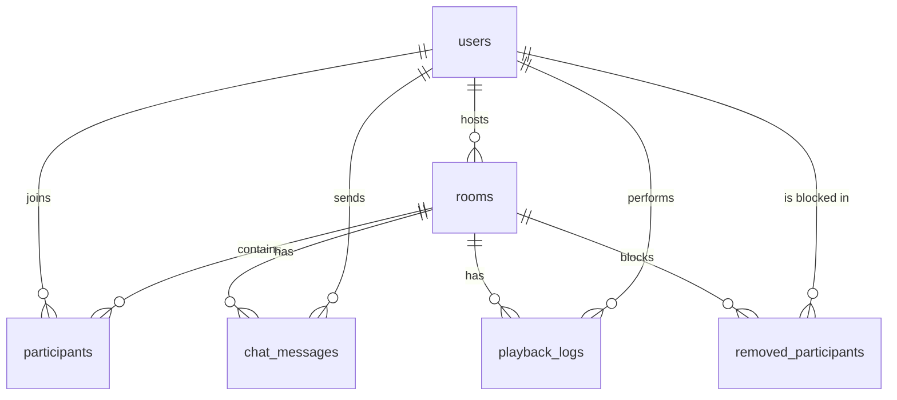

# Database

SyncStream uses PostgreSQL through Sequelize, hosted on Neon. All tables live in a `syncstream` schema, so they can't clash with other tables in the same database. On startup the server creates that schema and any missing tables inside it. It doesn't alter existing tables, so changing a column on a live database needs a manual migration.

Deleting a room or user also deletes the rows that belong to it.

| Table | Key columns | Purpose |
| --- | --- | --- |
| `users` | `id` (UUID), `username`, `emailAddress` (unique), `password` (bcrypt hash) | Accounts |
| `otps` | `id`, `email_address` (unique), `otp`, `expires_at` | Pending signup codes, deleted after signup |
| `rooms` | `id` (UUID), `host_id`, `created_by`, `title`, `current_video_id`, `current_playback_time`, `is_playing` | Rooms and their saved playback state |
| `participants` | `room_id` + `user_id`, `role`, `status` | Each user's role in a room. `role` is `HOST`, `MODERATOR` or `PARTICIPANT`; `status` is `ACTIVE` or `DISCONNECTED` |
| `removed_participants` | `room_id` + `user_id`, `removed_at` | Users the host removed, who can't rejoin that room |
| `chat_messages` | `id`, `room_id`, `user_id`, `message` | Chat history |
| `playback_logs` | `id`, `room_id`, `user_id`, `action`, `video_id`, `action_timestamp` | Playback history. `action` is `PLAY`, `PAUSE`, `SEEK` or `CHANGE_VIDEO` |

## What is not stored

Connected sockets, live participant lists and pending change requests are kept in memory by the `Room` class. Pending requests are lost if the server restarts.
